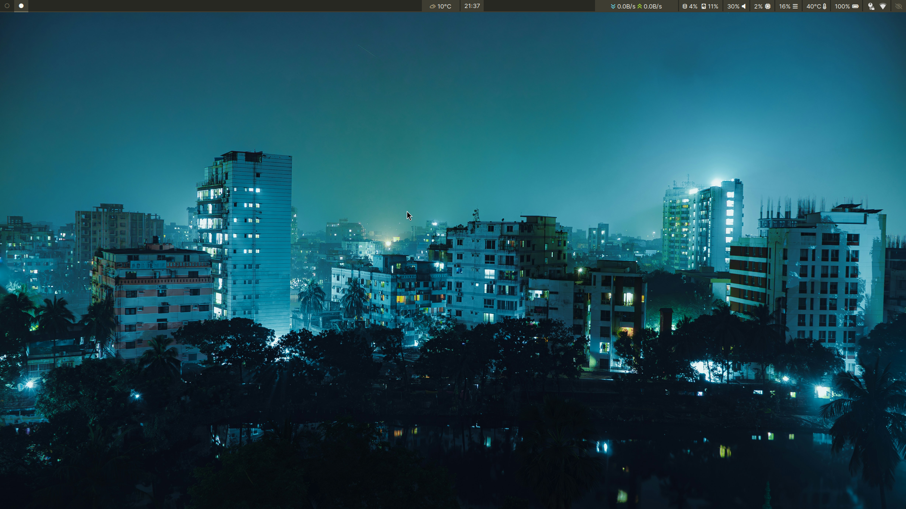

# dotlessdots

My Arch Linux dotfiles, managed as a bare Git repository with `$HOME` as the
working tree and the `dotfiles` wrapper as the Git frontend.

## Current setup

| Area | Tools |
| --- | --- |
| Compositor | [Niri](https://github.com/YaLTeR/niri) |
| Bar | Waybar |
| Launcher | Fuzzel |
| Notifications | Mako |
| Terminal | kitty |
| Shell | zsh |
| File manager | Thunar |
| Media | mpv |
| Editor | vim |
| Graphics | GIMP, Synfig, Inkscape |
| Wallpaper | awww |
| Lock / idle | swaylock, swayidle |
| Night light | wlsunset |
| Clipboard | cliphist |
| Audio | PipeWire (`wpctl`), playerctl |
| Brightness | brightnessctl |

## Repository layout

| Path | Purpose |
| --- | --- |
| `.config/niri/config.kdl` | Niri entrypoint; includes `conf.d/` |
| `.config/niri/conf.d/` | Input, outputs, layout, binds, startup, window rules |
| `.config/waybar/` | Waybar configuration and style |
| `.config/systemd/user/` | User units and timers |
| `.local/bin/` | Custom executables |
| `.agents/skills/` | Agent skills |
| `AGENTS.md` | Agent instructions |

## Custom scripts

| Script | Purpose |
| --- | --- |
| `power-menu` | Fuzzel power menu: lock, logout, suspend, reboot, shutdown |
| `display-scale` | Per-monitor scale switching and toggling |
| `wallpaper-rotate` | Rotates local and cached online wallpapers with awww |
| `clipboard-menu` | Cliphist picker |
| `waybar-weather` | Waybar weather module |
| `waybar-disk` | Waybar disk usage module |
| `vid-download` | Downloads a clipboard `yt-dlp` command |
| `drivesync` | Rclone Google Drive sync |
| `rsyncvps` | VPS backup helper |

## Local configuration

Machine-specific settings and credentials are kept out of Git. Copy the
example files and fill in your own values:

```bash
cp ~/.config/rsyncvps/config.example ~/.config/rsyncvps/config
cp ~/.config/vid-download/config.example ~/.config/vid-download/config
```

Other local configuration and cache directories are ignored by `.gitignore`.

## Screenshot


